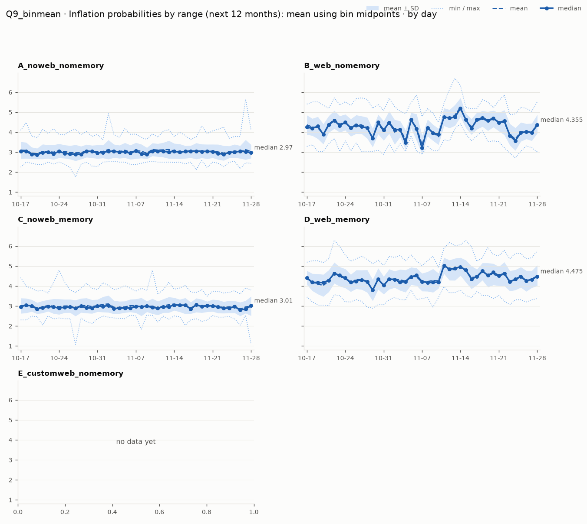
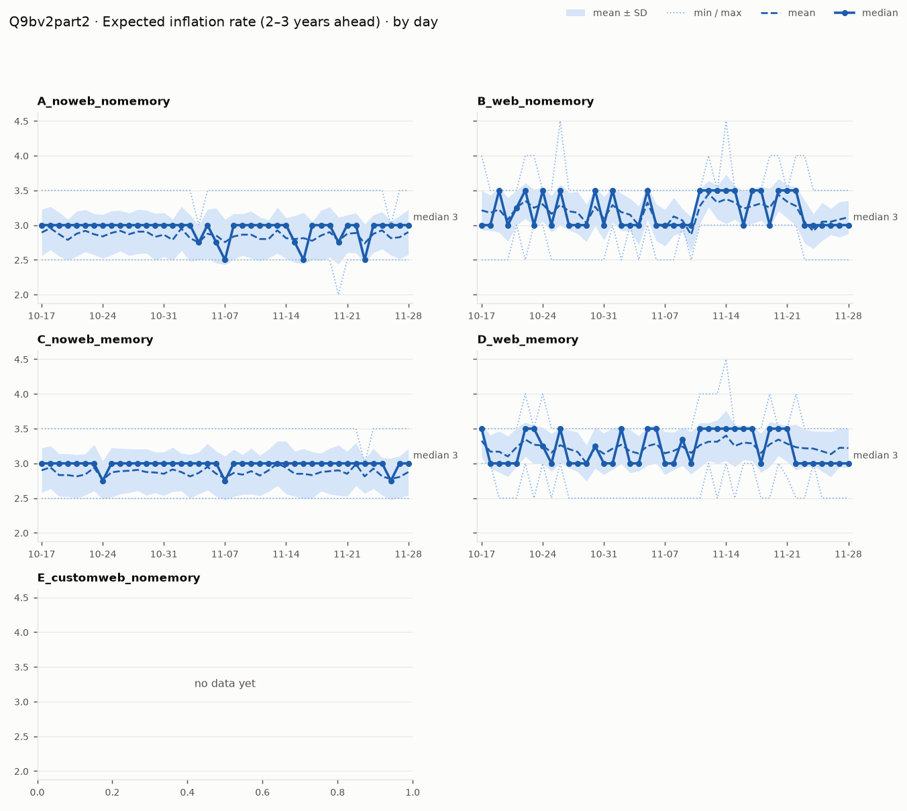
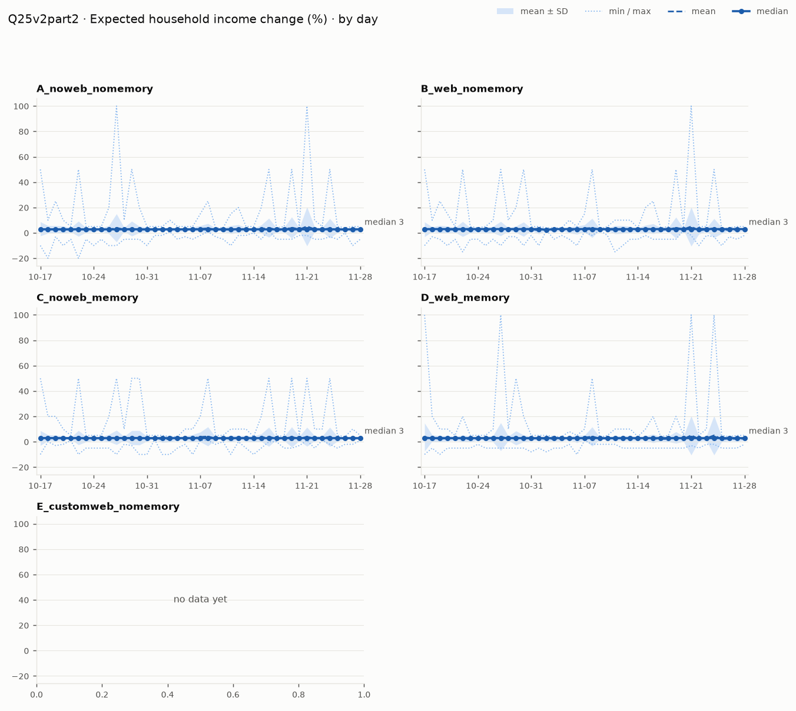
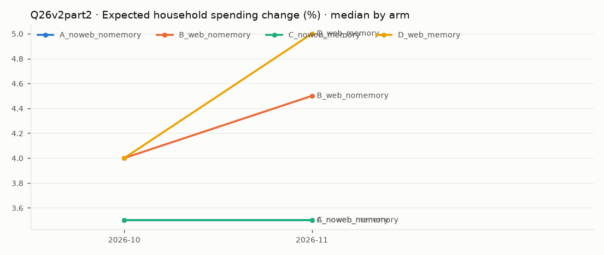
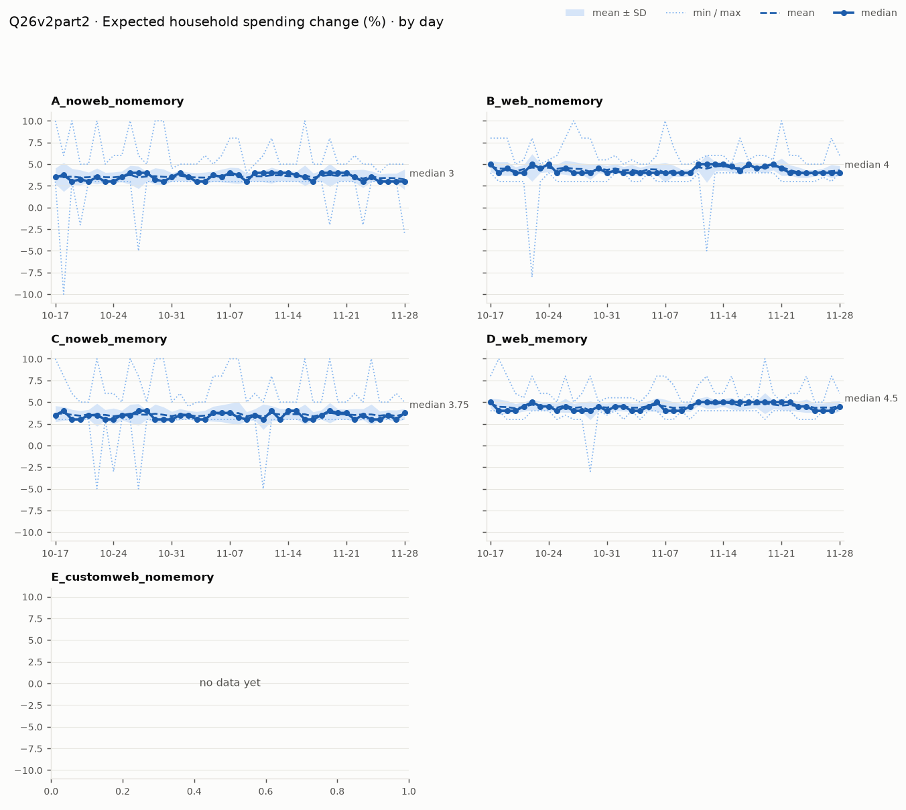
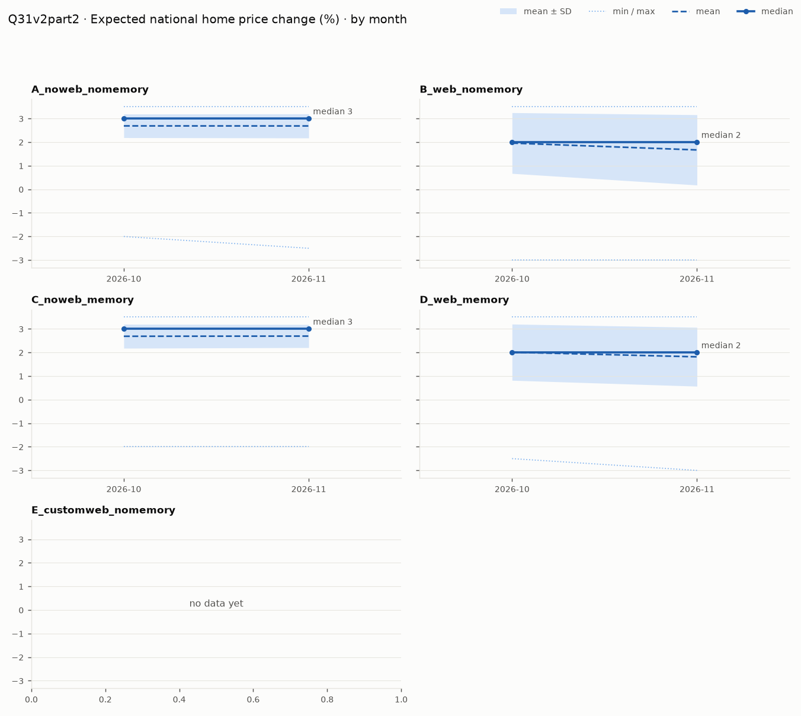

# SCE monthly survey · report

Updated 2026-11-28 13:11 · model `openai/gpt-6-luna` · arms: `A_noweb_nomemory` (web off, memory off), `B_web_nomemory` (web on, memory off), `C_noweb_memory` (web off, memory on), `D_web_memory` (web on, memory on), `E_customweb_nomemory` (web own searches, memory off, from 2026-12)

## Progress

| wave | arm | interviews | people | days | question_errors | reasks | cost_usd |
|---|---|---|---|---|---|---|---|
| 2026-10 | A_noweb_nomemory | 1200 | 1200 | 15 | 0 | 1 | 2.52 |
| 2026-10 | B_web_nomemory | 1200 | 1200 | 15 | 0 | 0 | 12.76 |
| 2026-10 | C_noweb_memory | 1200 | 1200 | 15 | 0 | 0 | 2.33 |
| 2026-10 | D_web_memory | 1200 | 1200 | 15 | 0 | 1 | 12.76 |
| 2026-11 | A_noweb_nomemory | 1120 | 1120 | 28 | 0 | 1 | 2.99 |
| 2026-11 | B_web_nomemory | 1120 | 1120 | 28 | 0 | 0 | 12.69 |
| 2026-11 | C_noweb_memory | 1120 | 1120 | 28 | 0 | 5 | 3.36 |
| 2026-11 | D_web_memory | 1120 | 1120 | 28 | 0 | 4 | 13.18 |

Total cost so far: **$62.58**

## 2026-11: headline items

| item | label | arm | n | median | mean | sd | min | max |
|---|---|---|---|---|---|---|---|---|
| Q8v2part2 | Expected inflation rate (next 12 months) | A_noweb_nomemory | 1120 | 3 | 3.19 | 0.25 | 3 | 4.5 |
| Q8v2part2 | Expected inflation rate (next 12 months) | B_web_nomemory | 1120 | 4 | 4.2 | 0.45 | 3.5 | 6.5 |
| Q8v2part2 | Expected inflation rate (next 12 months) | C_noweb_memory | 1120 | 3 | 3.19 | 0.25 | 3 | 4 |
| Q8v2part2 | Expected inflation rate (next 12 months) | D_web_memory | 1120 | 4.5 | 4.4 | 0.42 | 3.5 | 5.5 |
| Q9_binmean | Inflation probabilities by range (next 12 months): mean using bin midpoints | A_noweb_nomemory | 1120 | 3.01 | 3.05 | 0.36 | 2.11 | 5.65 |
| Q9_binmean | Inflation probabilities by range (next 12 months): mean using bin midpoints | B_web_nomemory | 1120 | 4.29 | 4.29 | 0.63 | 2.71 | 6.69 |
| Q9_binmean | Inflation probabilities by range (next 12 months): mean using bin midpoints | C_noweb_memory | 1120 | 2.95 | 2.98 | 0.34 | 1.08 | 4.79 |
| Q9_binmean | Inflation probabilities by range (next 12 months): mean using bin midpoints | D_web_memory | 1120 | 4.49 | 4.48 | 0.54 | 2.94 | 6.27 |
| Q9bv2part2 | Expected inflation rate (2–3 years ahead) | A_noweb_nomemory | 1120 | 3 | 2.84 | 0.32 | 2 | 3.5 |
| Q9bv2part2 | Expected inflation rate (2–3 years ahead) | B_web_nomemory | 1120 | 3 | 3.18 | 0.3 | 2.5 | 4.5 |
| Q9bv2part2 | Expected inflation rate (2–3 years ahead) | C_noweb_memory | 1120 | 3 | 2.87 | 0.32 | 2.5 | 3.5 |
| Q9bv2part2 | Expected inflation rate (2–3 years ahead) | D_web_memory | 1120 | 3.2 | 3.24 | 0.29 | 2.5 | 4.5 |
| Q4new | Chance U.S. unemployment is higher (12 months) | A_noweb_nomemory | 1120 | 55 | 53.57 | 4 | 40 | 65 |
| Q4new | Chance U.S. unemployment is higher (12 months) | B_web_nomemory | 1120 | 55 | 54.85 | 5.32 | 40 | 65 |
| Q4new | Chance U.S. unemployment is higher (12 months) | C_noweb_memory | 1120 | 55 | 53.56 | 3.98 | 40 | 60 |
| Q4new | Chance U.S. unemployment is higher (12 months) | D_web_memory | 1120 | 60 | 58.37 | 4.15 | 40 | 70 |
| Q5new | Chance savings interest rates are higher (12 months) | A_noweb_nomemory | 1120 | 50 | 50.23 | 3.52 | 35 | 60 |
| Q5new | Chance savings interest rates are higher (12 months) | B_web_nomemory | 1120 | 65 | 63.67 | 8.45 | 30 | 80 |
| Q5new | Chance savings interest rates are higher (12 months) | C_noweb_memory | 1120 | 50 | 50.58 | 3.31 | 35 | 60 |
| Q5new | Chance savings interest rates are higher (12 months) | D_web_memory | 1120 | 65 | 63.04 | 7.72 | 35 | 85 |
| Q6new | Chance U.S. stock prices are higher (12 months) | A_noweb_nomemory | 1120 | 60 | 58.19 | 4.57 | 45 | 65 |
| Q6new | Chance U.S. stock prices are higher (12 months) | B_web_nomemory | 1120 | 55 | 54.42 | 4.75 | 40 | 70 |
| Q6new | Chance U.S. stock prices are higher (12 months) | C_noweb_memory | 1120 | 60 | 57.86 | 4.49 | 40 | 65 |
| Q6new | Chance U.S. stock prices are higher (12 months) | D_web_memory | 1120 | 50 | 51.97 | 4.98 | 35 | 65 |
| Q13new | Chance of losing main job (12 months) | A_noweb_nomemory | 680 | 10 | 12.45 | 4.97 | 5 | 50 |
| Q13new | Chance of losing main job (12 months) | B_web_nomemory | 682 | 15 | 14.76 | 5.65 | 5 | 60 |
| Q13new | Chance of losing main job (12 months) | C_noweb_memory | 681 | 10 | 12.01 | 4.97 | 5 | 60 |
| Q13new | Chance of losing main job (12 months) | D_web_memory | 688 | 15 | 15.96 | 6 | 5 | 60 |
| Q25v2part2 | Expected household income change (%) | A_noweb_nomemory | 1120 | 3 | 2.94 | 4.29 | -10 | 100 |
| Q25v2part2 | Expected household income change (%) | B_web_nomemory | 1120 | 3 | 2.79 | 4.39 | -15 | 100 |
| Q25v2part2 | Expected household income change (%) | C_noweb_memory | 1120 | 3 | 2.92 | 3.69 | -10 | 50 |
| Q25v2part2 | Expected household income change (%) | D_web_memory | 1120 | 3 | 2.77 | 4.8 | -10 | 100 |
| Q26v2part2 | Expected household spending change (%) | A_noweb_nomemory | 1120 | 3.5 | 3.57 | 0.74 | -3 | 10 |
| Q26v2part2 | Expected household spending change (%) | B_web_nomemory | 1120 | 4 | 4.37 | 0.69 | -5 | 10 |
| Q26v2part2 | Expected household spending change (%) | C_noweb_memory | 1120 | 3.5 | 3.56 | 0.81 | -5 | 10 |
| Q26v2part2 | Expected household spending change (%) | D_web_memory | 1120 | 5 | 4.6 | 0.63 | 3 | 10 |
| Q30new | Chance of missing a minimum debt payment (3 months) | A_noweb_nomemory | 1120 | 5 | 7.26 | 6 | 0 | 40 |
| Q30new | Chance of missing a minimum debt payment (3 months) | B_web_nomemory | 1120 | 5 | 8.58 | 6.87 | 0 | 50 |
| Q30new | Chance of missing a minimum debt payment (3 months) | C_noweb_memory | 1120 | 5 | 7.13 | 6.06 | 0 | 60 |
| Q30new | Chance of missing a minimum debt payment (3 months) | D_web_memory | 1120 | 5 | 8.62 | 6.66 | 0 | 50 |
| Q31v2part2 | Expected national home price change (%) | A_noweb_nomemory | 1120 | 3 | 2.69 | 0.51 | -2.5 | 3.5 |
| Q31v2part2 | Expected national home price change (%) | B_web_nomemory | 1120 | 2 | 1.67 | 1.49 | -3 | 3.5 |
| Q31v2part2 | Expected national home price change (%) | C_noweb_memory | 1120 | 3 | 2.7 | 0.49 | -2 | 3.5 |
| Q31v2part2 | Expected national home price change (%) | D_web_memory | 1120 | 2 | 1.82 | 1.25 | -3 | 3.5 |

All items, by day and by month: [stats_daily.csv](stats_daily.csv) · [stats_monthly.csv](stats_monthly.csv) · one row per interview: [wide/](wide/)

## Trends

Solid line = median · dashed = mean · band = mean ± SD · dotted = min and max.

### Q8v2part2 · Expected inflation rate (next 12 months)

### Q9_binmean · Inflation probabilities by range (next 12 months): mean using bin midpoints

### Q9bv2part2 · Expected inflation rate (2–3 years ahead)

### Q4new · Chance U.S. unemployment is higher (12 months)

### Q5new · Chance savings interest rates are higher (12 months)

### Q6new · Chance U.S. stock prices are higher (12 months)

### Q13new · Chance of losing main job (12 months)

### Q25v2part2 · Expected household income change (%)

### Q26v2part2 · Expected household spending change (%)

### Q30new · Chance of missing a minimum debt payment (3 months)

### Q31v2part2 · Expected national home price change (%)

