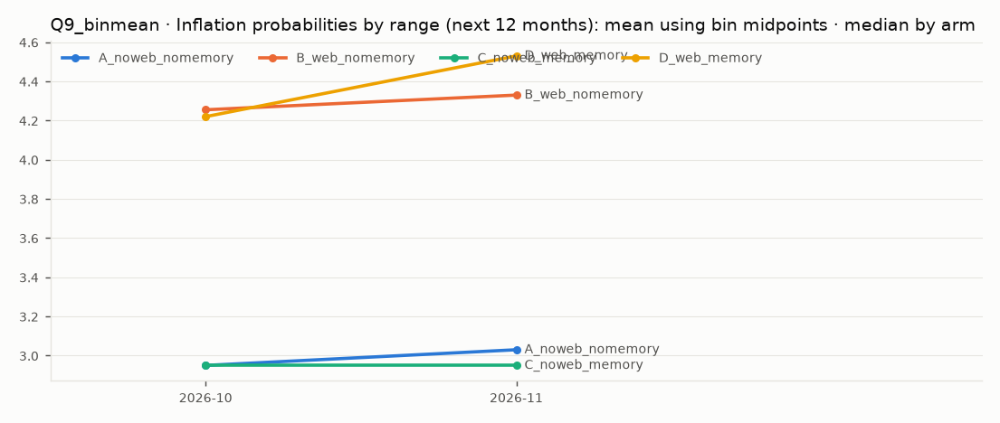
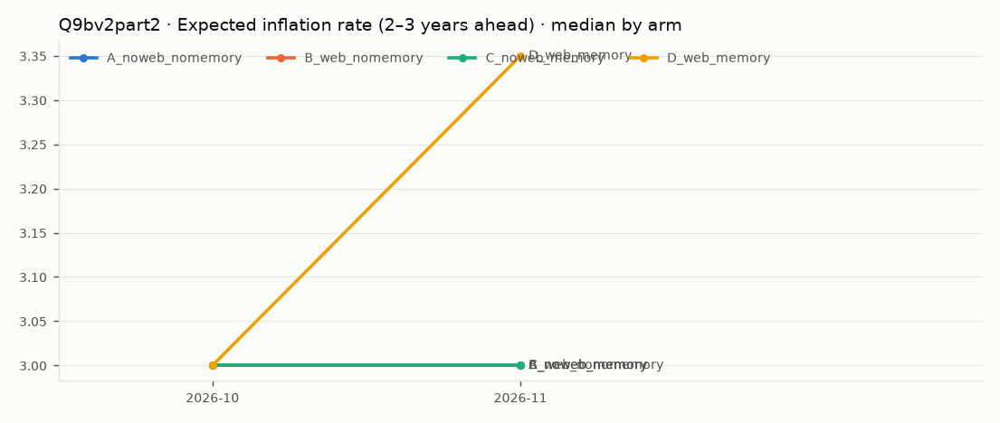
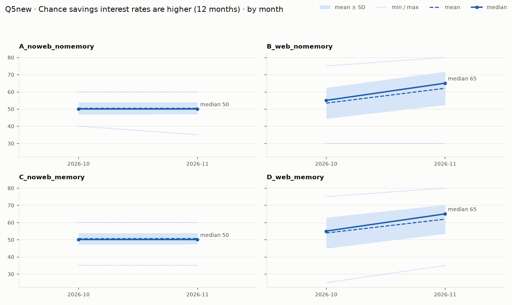
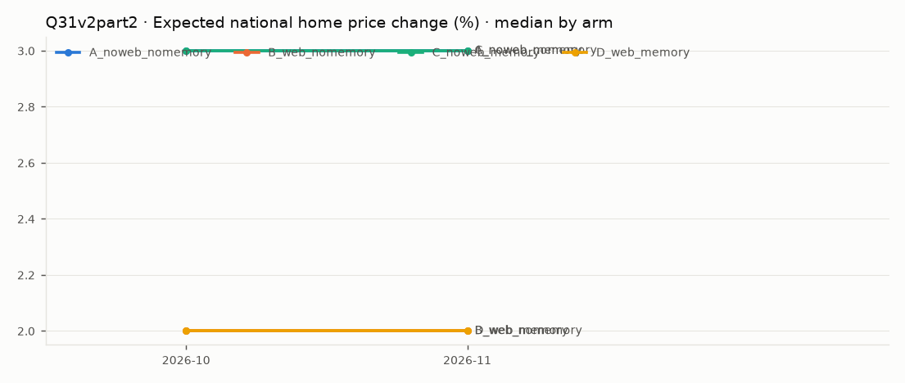

# SCE monthly survey · report

Updated 2026-11-18 13:14 · model `openai/gpt-6-luna` · arms: `A_noweb_nomemory` (web off, memory off), `B_web_nomemory` (web on, memory off), `C_noweb_memory` (web off, memory on), `D_web_memory` (web on, memory on)

## Progress

| wave | arm | interviews | people | days | question_errors | reasks | cost_usd |
|---|---|---|---|---|---|---|---|
| 2026-10 | A_noweb_nomemory | 1200 | 1200 | 15 | 0 | 1 | 2.52 |
| 2026-10 | B_web_nomemory | 1200 | 1200 | 15 | 0 | 0 | 12.76 |
| 2026-10 | C_noweb_memory | 1200 | 1200 | 15 | 0 | 0 | 2.33 |
| 2026-10 | D_web_memory | 1200 | 1200 | 15 | 0 | 1 | 12.76 |
| 2026-11 | A_noweb_nomemory | 720 | 720 | 18 | 0 | 0 | 1.92 |
| 2026-11 | B_web_nomemory | 720 | 720 | 18 | 0 | 0 | 8.16 |
| 2026-11 | C_noweb_memory | 720 | 720 | 18 | 0 | 4 | 2.16 |
| 2026-11 | D_web_memory | 720 | 720 | 18 | 0 | 1 | 8.46 |

Total cost so far: **$51.07**

## 2026-11: headline items

| item | label | arm | n | median | mean | sd | min | max |
|---|---|---|---|---|---|---|---|---|
| Q8v2part2 | Expected inflation rate (next 12 months) | A_noweb_nomemory | 720 | 3 | 3.22 | 0.26 | 3 | 4 |
| Q8v2part2 | Expected inflation rate (next 12 months) | B_web_nomemory | 720 | 4.5 | 4.24 | 0.46 | 3.5 | 6.5 |
| Q8v2part2 | Expected inflation rate (next 12 months) | C_noweb_memory | 720 | 3 | 3.2 | 0.25 | 3 | 4 |
| Q8v2part2 | Expected inflation rate (next 12 months) | D_web_memory | 720 | 4.5 | 4.43 | 0.43 | 3.5 | 5.5 |
| Q9_binmean | Inflation probabilities by range (next 12 months): mean using bin midpoints | A_noweb_nomemory | 720 | 3.03 | 3.06 | 0.36 | 2.11 | 4.92 |
| Q9_binmean | Inflation probabilities by range (next 12 months): mean using bin midpoints | B_web_nomemory | 720 | 4.33 | 4.33 | 0.65 | 2.89 | 6.69 |
| Q9_binmean | Inflation probabilities by range (next 12 months): mean using bin midpoints | C_noweb_memory | 720 | 2.95 | 3 | 0.35 | 1.84 | 4.79 |
| Q9_binmean | Inflation probabilities by range (next 12 months): mean using bin midpoints | D_web_memory | 720 | 4.53 | 4.5 | 0.55 | 2.94 | 6.27 |
| Q9bv2part2 | Expected inflation rate (2–3 years ahead) | A_noweb_nomemory | 720 | 3 | 2.83 | 0.32 | 2.5 | 3.5 |
| Q9bv2part2 | Expected inflation rate (2–3 years ahead) | B_web_nomemory | 720 | 3 | 3.2 | 0.3 | 2.5 | 4.5 |
| Q9bv2part2 | Expected inflation rate (2–3 years ahead) | C_noweb_memory | 720 | 3 | 2.87 | 0.32 | 2.5 | 3.5 |
| Q9bv2part2 | Expected inflation rate (2–3 years ahead) | D_web_memory | 720 | 3.35 | 3.24 | 0.3 | 2.5 | 4.5 |
| Q4new | Chance U.S. unemployment is higher (12 months) | A_noweb_nomemory | 720 | 55 | 53.88 | 3.97 | 40 | 65 |
| Q4new | Chance U.S. unemployment is higher (12 months) | B_web_nomemory | 720 | 55 | 55.26 | 5.09 | 40 | 65 |
| Q4new | Chance U.S. unemployment is higher (12 months) | C_noweb_memory | 720 | 55 | 53.67 | 4.04 | 40 | 60 |
| Q4new | Chance U.S. unemployment is higher (12 months) | D_web_memory | 720 | 60 | 58.42 | 4.24 | 40 | 70 |
| Q5new | Chance savings interest rates are higher (12 months) | A_noweb_nomemory | 720 | 50 | 50.39 | 3.46 | 35 | 60 |
| Q5new | Chance savings interest rates are higher (12 months) | B_web_nomemory | 720 | 65 | 62.03 | 9.67 | 30 | 80 |
| Q5new | Chance savings interest rates are higher (12 months) | C_noweb_memory | 720 | 50 | 50.63 | 3.3 | 35 | 60 |
| Q5new | Chance savings interest rates are higher (12 months) | D_web_memory | 720 | 65 | 61.91 | 8.4 | 35 | 80 |
| Q6new | Chance U.S. stock prices are higher (12 months) | A_noweb_nomemory | 720 | 60 | 58.12 | 4.56 | 45 | 65 |
| Q6new | Chance U.S. stock prices are higher (12 months) | B_web_nomemory | 720 | 55 | 54.61 | 4.69 | 40 | 65 |
| Q6new | Chance U.S. stock prices are higher (12 months) | C_noweb_memory | 720 | 60 | 57.9 | 4.56 | 40 | 65 |
| Q6new | Chance U.S. stock prices are higher (12 months) | D_web_memory | 720 | 55 | 52.22 | 4.96 | 40 | 65 |
| Q13new | Chance of losing main job (12 months) | A_noweb_nomemory | 449 | 10 | 12.67 | 5.16 | 5 | 50 |
| Q13new | Chance of losing main job (12 months) | B_web_nomemory | 450 | 15 | 15.01 | 5.82 | 5 | 60 |
| Q13new | Chance of losing main job (12 months) | C_noweb_memory | 450 | 10 | 12.12 | 5.04 | 5 | 60 |
| Q13new | Chance of losing main job (12 months) | D_web_memory | 453 | 15 | 16.23 | 6.28 | 5 | 60 |
| Q25v2part2 | Expected household income change (%) | A_noweb_nomemory | 720 | 3 | 2.85 | 2.7 | -10 | 50 |
| Q25v2part2 | Expected household income change (%) | B_web_nomemory | 720 | 3 | 2.69 | 2.92 | -15 | 50 |
| Q25v2part2 | Expected household income change (%) | C_noweb_memory | 720 | 3 | 2.86 | 3.24 | -10 | 50 |
| Q25v2part2 | Expected household income change (%) | D_web_memory | 720 | 3 | 2.64 | 2.61 | -10 | 50 |
| Q26v2part2 | Expected household spending change (%) | A_noweb_nomemory | 720 | 3.5 | 3.6 | 0.69 | 3 | 10 |
| Q26v2part2 | Expected household spending change (%) | B_web_nomemory | 720 | 4 | 4.41 | 0.71 | -5 | 10 |
| Q26v2part2 | Expected household spending change (%) | C_noweb_memory | 720 | 3.5 | 3.55 | 0.84 | -5 | 10 |
| Q26v2part2 | Expected household spending change (%) | D_web_memory | 720 | 5 | 4.62 | 0.6 | 3 | 8 |
| Q30new | Chance of missing a minimum debt payment (3 months) | A_noweb_nomemory | 720 | 5 | 7.28 | 5.82 | 0 | 35 |
| Q30new | Chance of missing a minimum debt payment (3 months) | B_web_nomemory | 720 | 5 | 8.57 | 6.48 | 0 | 50 |
| Q30new | Chance of missing a minimum debt payment (3 months) | C_noweb_memory | 720 | 5 | 7.14 | 5.82 | 0 | 50 |
| Q30new | Chance of missing a minimum debt payment (3 months) | D_web_memory | 720 | 5 | 8.69 | 6.54 | 0 | 50 |
| Q31v2part2 | Expected national home price change (%) | A_noweb_nomemory | 720 | 3 | 2.68 | 0.51 | -2.5 | 3.5 |
| Q31v2part2 | Expected national home price change (%) | B_web_nomemory | 720 | 2 | 1.92 | 1.37 | -3 | 3.5 |
| Q31v2part2 | Expected national home price change (%) | C_noweb_memory | 720 | 3 | 2.7 | 0.47 | 2 | 3.5 |
| Q31v2part2 | Expected national home price change (%) | D_web_memory | 720 | 2 | 1.93 | 1.23 | -3 | 3.5 |

All items, by day and by month: [stats_daily.csv](stats_daily.csv) · [stats_monthly.csv](stats_monthly.csv) · one row per interview: [wide/](wide/)

## Trends

Solid line = median · dashed = mean · band = mean ± SD · dotted = min and max.

### Q8v2part2 · Expected inflation rate (next 12 months)

### Q9_binmean · Inflation probabilities by range (next 12 months): mean using bin midpoints

### Q9bv2part2 · Expected inflation rate (2–3 years ahead)

### Q4new · Chance U.S. unemployment is higher (12 months)

### Q5new · Chance savings interest rates are higher (12 months)

### Q6new · Chance U.S. stock prices are higher (12 months)

### Q13new · Chance of losing main job (12 months)

### Q25v2part2 · Expected household income change (%)

### Q26v2part2 · Expected household spending change (%)

### Q30new · Chance of missing a minimum debt payment (3 months)

### Q31v2part2 · Expected national home price change (%)

