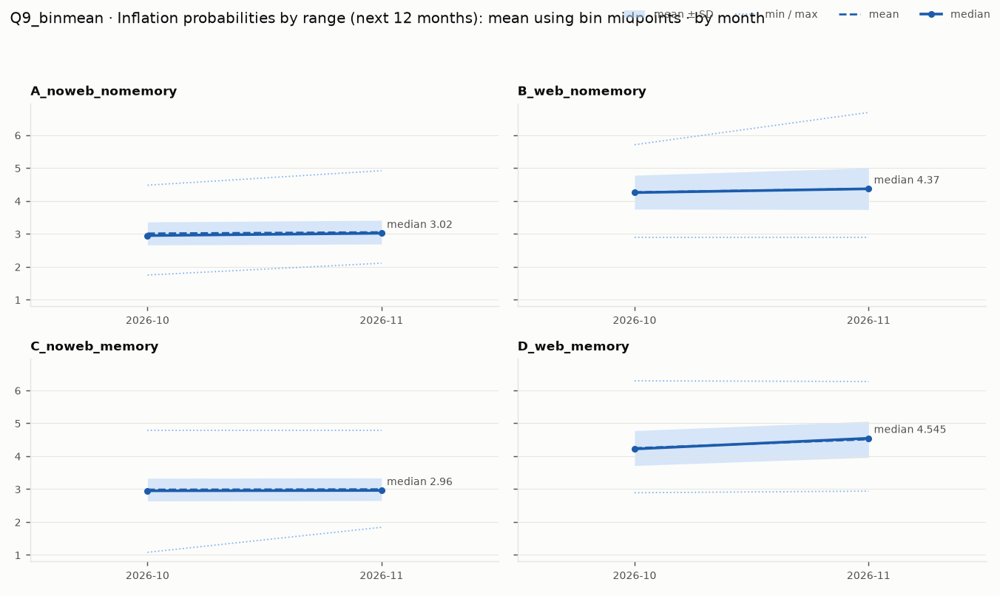
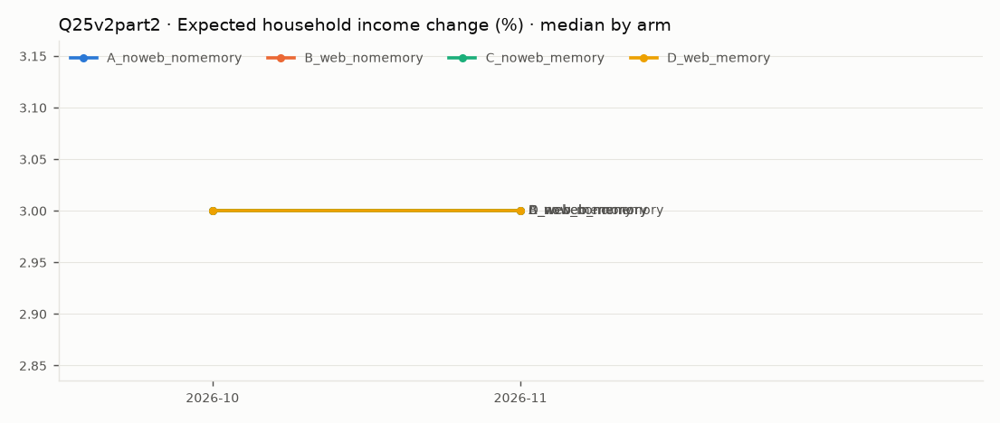
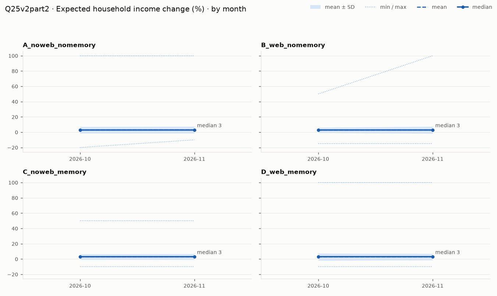

# SCE monthly survey · report

Updated 2026-11-22 13:10 · model `openai/gpt-6-luna` · arms: `A_noweb_nomemory` (web off, memory off), `B_web_nomemory` (web on, memory off), `C_noweb_memory` (web off, memory on), `D_web_memory` (web on, memory on)

## Progress

| wave | arm | interviews | people | days | question_errors | reasks | cost_usd |
|---|---|---|---|---|---|---|---|
| 2026-10 | A_noweb_nomemory | 1200 | 1200 | 15 | 0 | 1 | 2.52 |
| 2026-10 | B_web_nomemory | 1200 | 1200 | 15 | 0 | 0 | 12.76 |
| 2026-10 | C_noweb_memory | 1200 | 1200 | 15 | 0 | 0 | 2.33 |
| 2026-10 | D_web_memory | 1200 | 1200 | 15 | 0 | 1 | 12.76 |
| 2026-11 | A_noweb_nomemory | 880 | 880 | 22 | 0 | 0 | 2.34 |
| 2026-11 | B_web_nomemory | 880 | 880 | 22 | 0 | 0 | 9.96 |
| 2026-11 | C_noweb_memory | 880 | 880 | 22 | 0 | 5 | 2.63 |
| 2026-11 | D_web_memory | 880 | 880 | 22 | 0 | 3 | 10.34 |

Total cost so far: **$55.65**

## 2026-11: headline items

| item | label | arm | n | median | mean | sd | min | max |
|---|---|---|---|---|---|---|---|---|
| Q8v2part2 | Expected inflation rate (next 12 months) | A_noweb_nomemory | 880 | 3 | 3.22 | 0.26 | 3 | 4.5 |
| Q8v2part2 | Expected inflation rate (next 12 months) | B_web_nomemory | 880 | 4.5 | 4.28 | 0.45 | 3.5 | 6.5 |
| Q8v2part2 | Expected inflation rate (next 12 months) | C_noweb_memory | 880 | 3 | 3.2 | 0.25 | 3 | 4 |
| Q8v2part2 | Expected inflation rate (next 12 months) | D_web_memory | 880 | 4.5 | 4.44 | 0.44 | 3.5 | 5.5 |
| Q9_binmean | Inflation probabilities by range (next 12 months): mean using bin midpoints | A_noweb_nomemory | 880 | 3.02 | 3.05 | 0.36 | 2.11 | 4.92 |
| Q9_binmean | Inflation probabilities by range (next 12 months): mean using bin midpoints | B_web_nomemory | 880 | 4.37 | 4.37 | 0.63 | 2.89 | 6.69 |
| Q9_binmean | Inflation probabilities by range (next 12 months): mean using bin midpoints | C_noweb_memory | 880 | 2.96 | 3 | 0.34 | 1.84 | 4.79 |
| Q9_binmean | Inflation probabilities by range (next 12 months): mean using bin midpoints | D_web_memory | 880 | 4.54 | 4.51 | 0.55 | 2.94 | 6.27 |
| Q9bv2part2 | Expected inflation rate (2–3 years ahead) | A_noweb_nomemory | 880 | 3 | 2.83 | 0.32 | 2 | 3.5 |
| Q9bv2part2 | Expected inflation rate (2–3 years ahead) | B_web_nomemory | 880 | 3 | 3.22 | 0.29 | 2.5 | 4.5 |
| Q9bv2part2 | Expected inflation rate (2–3 years ahead) | C_noweb_memory | 880 | 3 | 2.88 | 0.32 | 2.5 | 3.5 |
| Q9bv2part2 | Expected inflation rate (2–3 years ahead) | D_web_memory | 880 | 3.5 | 3.25 | 0.29 | 2.5 | 4.5 |
| Q4new | Chance U.S. unemployment is higher (12 months) | A_noweb_nomemory | 880 | 55 | 53.89 | 3.93 | 40 | 65 |
| Q4new | Chance U.S. unemployment is higher (12 months) | B_web_nomemory | 880 | 55 | 55.14 | 5.1 | 40 | 65 |
| Q4new | Chance U.S. unemployment is higher (12 months) | C_noweb_memory | 880 | 55 | 53.71 | 4.04 | 40 | 60 |
| Q4new | Chance U.S. unemployment is higher (12 months) | D_web_memory | 880 | 60 | 58.34 | 4.17 | 40 | 70 |
| Q5new | Chance savings interest rates are higher (12 months) | A_noweb_nomemory | 880 | 50 | 50.39 | 3.49 | 35 | 60 |
| Q5new | Chance savings interest rates are higher (12 months) | B_web_nomemory | 880 | 65 | 62.98 | 9.16 | 30 | 80 |
| Q5new | Chance savings interest rates are higher (12 months) | C_noweb_memory | 880 | 50 | 50.64 | 3.38 | 35 | 60 |
| Q5new | Chance savings interest rates are higher (12 months) | D_web_memory | 880 | 65 | 62.51 | 8.11 | 35 | 80 |
| Q6new | Chance U.S. stock prices are higher (12 months) | A_noweb_nomemory | 880 | 60 | 58.11 | 4.58 | 45 | 65 |
| Q6new | Chance U.S. stock prices are higher (12 months) | B_web_nomemory | 880 | 55 | 54.32 | 4.87 | 40 | 70 |
| Q6new | Chance U.S. stock prices are higher (12 months) | C_noweb_memory | 880 | 60 | 57.81 | 4.56 | 40 | 65 |
| Q6new | Chance U.S. stock prices are higher (12 months) | D_web_memory | 880 | 50 | 51.94 | 5.03 | 40 | 65 |
| Q13new | Chance of losing main job (12 months) | A_noweb_nomemory | 533 | 10 | 12.68 | 5.16 | 5 | 50 |
| Q13new | Chance of losing main job (12 months) | B_web_nomemory | 534 | 15 | 15 | 5.89 | 5 | 60 |
| Q13new | Chance of losing main job (12 months) | C_noweb_memory | 534 | 10 | 12.14 | 5.1 | 5 | 60 |
| Q13new | Chance of losing main job (12 months) | D_web_memory | 540 | 15 | 16.12 | 6.19 | 5 | 60 |
| Q25v2part2 | Expected household income change (%) | A_noweb_nomemory | 880 | 3 | 3.02 | 4.48 | -10 | 100 |
| Q25v2part2 | Expected household income change (%) | B_web_nomemory | 880 | 3 | 2.83 | 4.62 | -15 | 100 |
| Q25v2part2 | Expected household income change (%) | C_noweb_memory | 880 | 3 | 2.92 | 3.78 | -10 | 50 |
| Q25v2part2 | Expected household income change (%) | D_web_memory | 880 | 3 | 2.75 | 4.2 | -10 | 100 |
| Q26v2part2 | Expected household spending change (%) | A_noweb_nomemory | 880 | 3.5 | 3.62 | 0.73 | -2 | 10 |
| Q26v2part2 | Expected household spending change (%) | B_web_nomemory | 880 | 4 | 4.44 | 0.71 | -5 | 10 |
| Q26v2part2 | Expected household spending change (%) | C_noweb_memory | 880 | 3.5 | 3.57 | 0.83 | -5 | 10 |
| Q26v2part2 | Expected household spending change (%) | D_web_memory | 880 | 5 | 4.64 | 0.63 | 3 | 10 |
| Q30new | Chance of missing a minimum debt payment (3 months) | A_noweb_nomemory | 880 | 5 | 7.43 | 6 | 0 | 40 |
| Q30new | Chance of missing a minimum debt payment (3 months) | B_web_nomemory | 880 | 5 | 8.8 | 7 | 0 | 50 |
| Q30new | Chance of missing a minimum debt payment (3 months) | C_noweb_memory | 880 | 5 | 7.22 | 5.9 | 0 | 50 |
| Q30new | Chance of missing a minimum debt payment (3 months) | D_web_memory | 880 | 5 | 8.72 | 6.61 | 0 | 50 |
| Q31v2part2 | Expected national home price change (%) | A_noweb_nomemory | 880 | 3 | 2.69 | 0.5 | -2.5 | 3.5 |
| Q31v2part2 | Expected national home price change (%) | B_web_nomemory | 880 | 2 | 1.71 | 1.56 | -3 | 3.5 |
| Q31v2part2 | Expected national home price change (%) | C_noweb_memory | 880 | 3 | 2.69 | 0.5 | -2 | 3.5 |
| Q31v2part2 | Expected national home price change (%) | D_web_memory | 880 | 2 | 1.85 | 1.28 | -3 | 3.5 |

All items, by day and by month: [stats_daily.csv](stats_daily.csv) · [stats_monthly.csv](stats_monthly.csv) · one row per interview: [wide/](wide/)

## Trends

Solid line = median · dashed = mean · band = mean ± SD · dotted = min and max.

### Q8v2part2 · Expected inflation rate (next 12 months)

### Q9_binmean · Inflation probabilities by range (next 12 months): mean using bin midpoints

### Q9bv2part2 · Expected inflation rate (2–3 years ahead)

### Q4new · Chance U.S. unemployment is higher (12 months)

### Q5new · Chance savings interest rates are higher (12 months)

### Q6new · Chance U.S. stock prices are higher (12 months)

### Q13new · Chance of losing main job (12 months)

### Q25v2part2 · Expected household income change (%)

### Q26v2part2 · Expected household spending change (%)

### Q30new · Chance of missing a minimum debt payment (3 months)

### Q31v2part2 · Expected national home price change (%)

